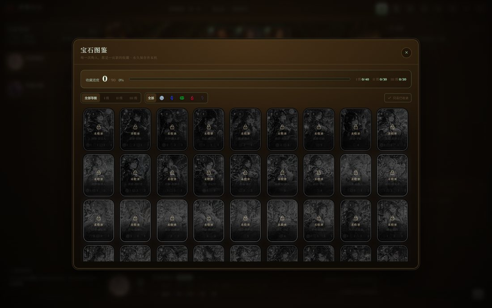

# 璀璨宝石 · Splendor Lands

一款多风格、重收藏的《璀璨宝石》（Splendor）网页桌游：暗色酒馆、鎏金卡框、宝石光效，支持 2–4 人在线联机、房间创建/加入、断线重连、电脑对手，以及手机横屏游玩。三种卡面画风各有独立的卡框语言与 90 个专属卡名。

> 非官方粉丝作品。卡面与贵族肖像由 AI 绘制，规则遵循 Marc André 的 Splendor。


| 牌桌 | 皮肤工坊 |
| --- | --- |
|  |  |



## 功能

- **多人联机**：创建 / 加入房间，房间固定 4 个席位、**2 人即可开局**，无需在创建时决定人数；房间默认**私密**（只有拿到房间号或邀请链接的人能加入），房主可在房间内一键切换为公开、显示在大厅房间列表；房主可添加电脑玩家，分享房间号或邀请链接即可入席。
- **单页布局**：大厅、房间、牌桌都固定铺满视口，整页不滚动；只有房间列表、战报、聊天、规则弹窗等局部区域内部滚动。
- **完整规则**：拿取宝石、黄金预订、购买发展卡、贵族来访、宝石超载归还、15 声望触发最后一轮、平局按发展卡数量判定。
- **断线重连**：刷新或掉线后凭本地会话自动回到原座位；玩家中途离开由电脑接管。
- **电脑对手**：内置策略机器人，可随时补位，也支持房主单人练习。
- **皮肤工坊**：卡框主题、卡面画风、宝石样式、卡背、桌面、贵族、头像共 7 类外观，实时预览并保存在本机。卡面包含 90 张传奇油画、90 张彩窗圣殿，以及「星轨绘旅」动漫主题（90 张逐卡独立的动漫幻想原画），整张替换而非滤镜。三套画风各有独立的卡框、材质与 **90 个专属卡名**（例：同一张三级红卡 = 浴火凤凰 / 红莲圣女 / 焰羽·誓约者），换肤即换名，战报与详情同步切换。
- **永久宝石图鉴**：自己实际购入的发展卡会自动点亮图鉴，保留未购买的卡不计入；支持等级、颜色与已收录筛选、大图预览和收集进度，收藏保存在本机并在刷新后保留。
- **手机横屏**：≤920px 或 ≤560px 高时自动切换为紧凑牌桌，宝石银行、卡牌分页、玩家与聊天改为底部抽屉。
- **回合限时**：房主可在房间内选择每回合 30 / 60 / 90 秒或不限时；桌面与手机都会显示倒计时，最后 5 秒转为醒目的红色脉冲，超时自动跳过该回合（贵族选择与超载归还也会自动处理）。
- **氛围细节**：程序化合成音效与酒馆背景音乐、战报与聊天、卡牌详情、贵族肖像、回合提示、响应式缩放。

## 快速开始

环境：Node.js ≥ 20（推荐 22/24）。

**最简单的方式**：双击根目录的 `启动游戏.bat`。
它会自动检查依赖、按需构建、启动服务器并在就绪后打开浏览器；
如果 3001 端口被占用，会自动换到 3002 及之后的空闲端口。
关闭黑窗口不会停止服务器，要停止请双击 `停止游戏.bat`。

也可以手动运行：

```bash
npm install
npm run dev      # 开发模式：前端 5173 + 服务端 3001
# 或
npm start        # 生产模式：仅 3001（需先 npm run build）
```

- 开发模式前端：<http://localhost:5173>
- 服务端：<http://localhost:3001>（WebSocket：`/ws`）

开发模式下 Vite 会把 `/api` 与 `/ws` 代理到 3001。

## 生产部署

```bash
npm run build
npm start
```

构建产物输出到 `dist/`，由 Express 在 3001 端口同时托管静态资源与 WebSocket。浏览器访问 <http://localhost:3001>。

**在线游玩**：<https://splendor.zulogic.cn>

线上版本运行在 Ubuntu + systemd 上，由 1Panel OpenResty（Nginx）反向代理到仅监听 `127.0.0.1:3101` 的 Node 服务；HTTPS 使用 `*.zulogic.cn` 通配符证书，`/ws` 已配置 WebSocket 升级与长连接超时。房间状态保存在内存中，服务重启会清空房间。

修改端口：

```bash
# Windows PowerShell
$env:PORT=8080; npm start
# macOS / Linux
PORT=8080 npm start
```

### 局域网联机

1. 在一台机器上执行 `npm run build && npm start`。
2. 查看本机内网 IP（Windows：`ipconfig`）。
3. 其他玩家访问 `http://<内网IP>:3001`，房主创建房间后把房间号或邀请链接发给他们。
4. 若无法访问，请放行 3001 端口的防火墙入站规则。

> 公网部署时建议放在 Nginx/Caddy 反向代理之后，并开启 WebSocket 升级（`/ws`）。游戏不依赖数据库，房间状态保存在内存中，重启服务器会清空房间。

## 玩法速览

- 每回合选择一项：**拿宝石**（3 种不同颜色各 1 枚，或银行中某色 ≥4 时拿 2 枚同色）、**预订卡牌**（拿 1 枚黄金，手牌上限 3）、**购买卡牌**（可买明牌或自己的保留卡，可用黄金替代任意宝石）。
- 官方供应：2/3/4 人局每种宝石分别为 **4/5/7 枚**，黄金始终 5 枚，贵族数量均为人数 + 1。
- 发展卡提供永久宝石加成与声望；达到 15 声望触发最后一轮，轮次结束后分高者胜，同分则发展卡少者胜。
- 贵族会主动来访：满足其宝石加成要求后，回合结束时迎接获得 3 声望。

## 操作

- 点击银行宝石选择，选满后点击「拿取宝石」；再点一次取消选择。
- 点击场上卡牌查看详情，可购买或预订；点击牌堆可盲抽预订。
- 首页三张随机卡牌会随画风换名换框，点击可打开大图鉴赏；皮肤工坊内可并排比较同一张卡的三种形态。
- 点击贵族查看需求；满足多位贵族条件时可选择迎接其中一位。
- 点击顶栏的卷轴查看战报、对话框聊天；调色板打开皮肤工坊，书本查看规则，图签图标打开永久宝石图鉴。
- 宝石超过 10 枚时需要归还，按弹窗提示操作。
- 手机上：点顶部按钮打开战报 / 聊天 / 更多（规则、皮肤、玩家详情），三级卡牌用 I / II / III 标签切换。

## 项目结构

```
Splendor/
├─ server/            Express + ws 服务端
│  ├─ index.mjs       HTTP/WebSocket 入口、消息路由
│  └─ rooms.mjs       房间、座位、对局与机器人调度
├─ shared/
│  ├─ rules.mjs       纯函数规则引擎（服务端权威）
│  ├─ bot.mjs         电脑玩家策略
│  ├─ cards.json      90 张发展卡（构建生成）
│  ├─ nobles.json     10 位贵族（构建生成）
│  └─ data.mjs        供 Node 脚本导入的数据模块
├─ src/               React + TypeScript 前端
│  ├─ components/     大厅、房间、牌桌、弹窗与通用组件
│  ├─ lib/            类型、元数据、皮肤、音效、WebSocket
│  ├─ styles/         base / cards / game / lobby / extra / collection / mobile
│  └─ store.ts        全局状态与网络动作
├─ data/              原始 CSV（卡牌、贵族）
├─ public/assets/art/ 已优化的 WebP 美术资源
├─ art-src/           原始 PNG（归档）
├─ scripts/           数据构建、资源优化、模拟与 Playwright 截图脚本
└─ dist/              生产构建输出
```

## 规则与数据

- 发展卡数据：90 张，等级 1/2/3，五色加成，成本与声望遵循原版。
- 贵族：10 位，均 3 声望。
- 规则引擎位于 `shared/rules.mjs`，服务端对每一步动作做合法性校验；`scripts/simulate.mjs` 可无界面模拟大量对局。

```bash
npm run sim            # 2/3/4 人各模拟 40 局，输出错误与平均回合
node scripts/simulate.mjs 100 4
```

## 开发脚本

```bash
npm run build          # 类型检查 + Vite 构建
npm test               # 官方数值、保留卡购买、图鉴去重与三套卡名回归测试
npm run sim            # 规则模拟
npm run assets         # 重新压缩 art-src 中的原图
npm run gems           # 重新抠图并生成宝石素材
node scripts/anime-assets.mjs # 压缩动漫原图并生成预览 contact sheet
node scripts/shot.mjs http://localhost:5173 lobby 1600 1000
node scripts/flow.mjs  # 创建房间 → 加电脑 → 开局 → 截图
node scripts/playtoend.mjs  # 自动打完整局
node scripts/multiplayer.mjs # 双人联机 + 刷新重连测试
node scripts/mobile.mjs      # 844×390 手机横屏全流程测试
node scripts/reserved-purchase.mjs # 桌面 + 手机保留卡购买及图鉴收录
node scripts/art-check.mjs   # 动漫皮肤、随机首页卡牌与空图鉴界面
node scripts/skin-gallery.mjs # 三套画风并排对比与首页三档尺寸
node scripts/lightbox.mjs     # 首页卡牌点击大图鉴赏
```

截图脚本使用本机 Chrome（`C:\Program Files\Google\Chrome\Application\chrome.exe`），输出到 `shots/`。

## 美术与皮肤

- 90 张发展卡各有一张传奇油画，另有第二套「彩窗圣殿」画风（同样 90 张，逐卡对应）。第三套「星轨绘旅」同样为 **90 张逐卡独立**的动漫幻想原画，原图 1024×1536、WebP 640×960，不再复用同一张立绘。
- 三套画风的卡名彼此独立：传奇油画为文艺复兴商号，彩窗圣殿为圣殿祷歌式名号，星轨绘旅为「称号·人名」的二次元命名；皮肤工坊可并排对比同一张卡的三种形态。
- 10 位贵族各有油画、彩窗与动漫三版肖像；3 张牌背、4 张桌面背景；头像可选用任意卡面或贵族肖像。
- 宝石为 4 套独立素材（切面宝石 / 古国金币 / 原始晶簇 / 秘法符文），每套 6 枚、外形各异：钻石为圆形明亮式、蓝宝石为椭圆、祖母绿为祖母绿方切、红宝石为梨形、黑曜石为马眼、黄金为金币。
- 所有图片经 `scripts/optimize-assets.mjs`、`scripts/gem-assets.mjs`（sharp）压缩为 WebP：卡面 512×680、贵族 480×560、牌背 540×760、桌面 1600×900、宝石 256×256 透明底。
- 卡面原画为 2:3 竖幅，卡牌为 0.79 比例，缩放时统一**顶部对齐裁切**，保证人物头部不会被切掉；传奇油画与星轨绘旅为满铺构图，彩窗圣殿则把原画嵌入哥特尖拱窗内，名字与成本压在底部渐变之上。
- 皮肤通过 `data-*` 属性、CSS 与资源路径切换，整张卡面替换；三套卡面画风各自拥有独立的卡框结构与命名表，头像变更会同步给同房间玩家。

## 音效与音乐

- 音效由 Web Audio 实时合成（点击、拿宝石、购卡、回合提示、贵族来访、胜利等），无需音频文件。
- 背景音乐同样是程序化生成：`src/lib/music.ts` 用三角波拨弦、锯齿波铺底与带通噪声手鼓，在 D 小调五声音阶上循环即兴，营造酒馆氛围；首次点击页面后自动开始，可在顶栏音符按钮开关。
- 动效：发牌入场、宝石飞入钱包、购买/贵族飘字、回合横幅、贵族来访脉冲、牌桌浮尘等，均遵循 `prefers-reduced-motion`。


## AI 对手：从启发式到神经网络

困难电脑是一个**在 GPU 上训练的神经网络策略**，不是规则表。

### 网络长什么样（`train/model.py`）

把牌桌当成一个**集合**而不是固定字段，全部喂给 Transformer：

- **感知（perception）**：12 张明牌、5 位贵族、4 名玩家各自编码成一个 16/12/18 维向量，
  加上类型嵌入与位置嵌入，共 22 个 token 送进 3 层 Pre-LN Transformer（d=96，4 头）。
  模型不需要知道"第几张卡"，靠自注意力自己发现"这张卡补上了我缺的祖母绿"。
- **目标意图（goal latent）**：额外一个可学习的 query 专门对牌面做注意力，
  挑出"我打算买的卡"，它的输出与池化出的状态向量一起参与打分 —— 这就是"目标感"。
- **指针式决策（pointer policy）**：每个合法动作编码成 40 维向量，
  用 `dot(state+goal, action_emb) / sqrt(d)` 打分。动作数随局面变化（15~90 个）也天然适配。
- **对手建模**：玩家 token 带 `is_self` 标记，注意力可跨玩家比较；
  辅助头显式预测"对手下一手会买哪张卡""下一位来访贵族"，逼表征里包含对手意图。
- **表达（expression）**：一个 8 维"意图语义向量" + 5 类意图分类头
  （抢分 / 补齐宝石 / 争取贵族 / 补加成 / 预订卡位）。困难电脑会在战报里
  随机播报它此刻的打算，例如「大商人科西莫 暗自盘算：争取贵族」。

### 怎么训练

1. **行为克隆热身**（`train/bc.py`）：先用启发式强 AI 自对弈生成 28k 条决策
   （`scripts/gen-imitation.mjs`），监督训练策略头，10 轮后动作一致率约 63%。
   这一步让网络迅速脱离"随机水平"。
2. **自对弈强化学习**（`train/train.py`）：PPO + 按局分组的优势估计 + 熵正则，
   2/3/4 人混合自对弈，温度采样并保留 6% 探索。
3. **导出**（`train/export_weights.py`）：权重写成 `shared/nn-weights.json`，
   由 `shared/nn.mjs` 用**纯 JS** 前向推理（无 onnxruntime、无 Python 依赖），
   单步约 15 ms，首页零额外体积。

### 实战表现（`scripts/nn-duel.mjs`）

| 对阵 | 结果 |
|---|---|
| 神经网络 vs 普通 | 12 局 8 胜 4 负（66.7%） |
| 神经网络 vs 困难（启发式+前瞻） | 24 局 14 胜 10 负（58.3%） |
| 启发式困难 vs 普通 | 60 局 35 胜 25 负（58.3%） |

困难电脑实际使用的是**混合决策**：网络的策略分布给出候选与先验，
再对所有候选（启发式候选 ∪ 网络 top-8）做一次快速 rollout 估值取最优。
这样保留了网络的全局感知，又不会因策略网络的小误差直接走坏棋。

### 复现命令

```bash
npm run ai:data     # 生成行为克隆数据集
npm run ai:bc       # 克隆训练（约 2 分钟，GTX 1660 Ti）
npm run ai:export   # 导出权重到 shared/nn-weights.json
npm run ai:duel     # 神经网络 vs 启发式对战
```

> 没有 `nn-weights.json` 时，困难电脑会自动回退到启发式 + rollout，功能不受影响。

## 技术栈

React 18 · TypeScript · Vite 6 · Express 4 · ws 8 · Web Audio · 原生 CSS 变量主题。没有 UI 框架与状态库，单人可维护。

## 开源与许可

- 本仓库代码以 **MIT** 许可发布，详见 [LICENSE](LICENSE)。
- 这是非官方粉丝作品，与 Space Cowboys / Asmodee 无关；Splendor 的名称与规则版权归原作者 Marc André 与发行方所有，请勿用于商业用途。
- 卡牌、贵族、桌面等插画由 AI 生成，用于本项目的非商业展示；运行时素材位于 `public/assets/`。体积较大的原始生成图（`art-src/`）、截图（`shots/`）与训练产物不随仓库发布。
- 欢迎 Issue 与 PR。提交前请运行 `npm test` 与 `npm run build`，CI 会在 Node 22 上执行同样的检查。

